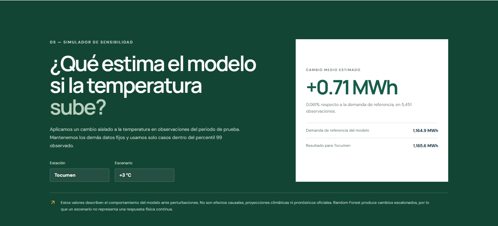

# EnerClima Panamá

[](https://charrixxz23.github.io/enerclima-panama/)

**[Abrir la aplicación EnerClima Panamá](https://charrixxz23.github.io/enerclima-panama/)**

<p align="center"></p>

> **Cuando el clima cambia, la demanda también.** Exploramos señales climáticas y energéticas para entender mejor el sistema eléctrico panameño.


## El problema que estudiamos

En este proyecto analizamos cómo se relacionan las temperaturas observadas en Tocumen, Santiago y David con la demanda eléctrica nacional de Panamá. El calor puede cambiar las necesidades de refrigeración y coincide con patrones horarios y estacionales de consumo. Una lectura cuidadosa de estas señales aporta contexto para la planificación energética y ambiental.

Trabajamos con una serie horaria entre enero de 2015 y junio de 2020. El conjunto reúne 48,048 registros y 17 variables. La demanda está expresada en MWh por intervalo horario, según los metadatos recibidos.

## Hallazgos principales

- Nuestro modelo Random Forest obtuvo un MAE de **19.61 MWh**, un RMSE de **27.72 MWh** y un MAPE de **1.66%** en la prueba temporal.
- En las horas sobre el percentil 95 de temperatura, la demanda media fue cerca de **200 MWh mayor** que en las demás horas. Esta diferencia es descriptiva y no atribuye causalidad.
- Evaluamos por separado la referencia semanal de predespacho en 14 ventanas oficiales: MAE **59.20 MWh** y RMSE **74.03 MWh**.
- El modelo de una hora usa clima observado en la misma hora objetivo; por ello sus resultados son retrospectivos y no representan un pronóstico operativo.

## Qué podemos explorar

- Consultamos métricas y series agregadas de demanda nacional.
- Comparamos condiciones climáticas de las tres estaciones de referencia y vemos su mapa.
- Revisamos eventos sobre los umbrales descriptivos de temperatura.
- Comparamos modelos temporales y la referencia semanal del predespacho.
- Ajustamos escenarios de temperatura en un simulador basado en el modelo.
- Leemos metodología, referencias y limitaciones junto a los resultados.



## Tecnologías y arquitectura

- **Análisis:** Python, pandas, NumPy, scikit-learn y Jupyter.
- **Observatorio:** Next.js, React, TypeScript, Recharts y React Leaflet.
- **Publicación:** exportación estática de Next.js, GitHub Actions y GitHub Pages.
- **Datos del sitio:** JSON agregado precalculado en `web/public/data/dashboard.json`; el navegador no necesita Python ni un servidor de análisis.

```text
scripts/             auditoría, análisis y exportación de métricas
notebooks/           cuaderno reproducible con resultados ejecutados
data/metadata/       diccionario de variables
results/             métricas agregadas, tablas y figuras
web/                 aplicación estática y pruebas de navegador
docs/                fuentes, límites, auditoría y cumplimiento
entregables/         materiales académicos privados, excluidos de Git
```

## Ejecución local

### Análisis en Python

Conservamos los datos fuente fuera del repositorio, en `data/raw/`. Descargamos el conjunto desde su fuente oficial cuando tengamos los permisos correspondientes o usamos una copia de trabajo autorizada. Para reproducir el análisis, creamos un entorno virtual y ejecutamos:

```powershell
python -m venv "$env:LOCALAPPDATA\EnerClima-Panama-venv"
& "$env:LOCALAPPDATA\EnerClima-Panama-venv\Scripts\Activate.ps1"
python -m pip install -r requirements.txt
python scripts/run_analysis.py
python scripts/export_web_data.py
```

El código construye rutas relativas desde el proyecto y funciona con espacios y tildes en la ruta. En Linux y Google Colab usamos la misma estructura del proyecto y el entorno equivalente.

### Aplicación web

Requerimos Node.js 20.9 o posterior. Desde `web/` instalamos paquetes y ejecutamos las comprobaciones y el sitio:

```bash
npm ci
npm run lint
npm run typecheck
npm run test:e2e
npm run dev
```

Para probar la exportación de GitHub Pages en Windows PowerShell:

```powershell
$env:GITHUB_PAGES = "true"
$env:NEXT_PUBLIC_BASE_PATH = "/enerclima-panama"
npm run build
```

La compilación estática aparece en `web/out/`. GitHub Actions instala las dependencias, ejecuta lint, tipos y pruebas de navegador, compila y publica ese directorio cuando recibe cambios en `main`.

## Integrantes

Alejandro Muñoz, Angie Valdés, Richard Smith y Abisai Bellamy. Realizamos el proyecto para Ingeniería Ambiental en la Universidad Tecnológica de Panamá, bajo la orientación de la profesora Vivian Valenzuela.

## Fuentes

- Aguilar Madrid, J. A. y Antonio, N. (2021). “Short-Term Electricity Load Forecasting with Machine Learning”. *Information, 12*(2), 50. [https://doi.org/10.3390/info12020050](https://doi.org/10.3390/info12020050)
- Aguilar Madrid, J. A. (2021). *Short-term electricity load forecasting (Panama)*. Mendeley Data, v1. [https://doi.org/10.17632/byx7sztj59.1](https://doi.org/10.17632/byx7sztj59.1)
- NASA. Documentación de variables meteorológicas MERRA-2 y NASA POWER.
- IPCC. *Climate Change 2022: Impacts, Adaptation and Vulnerability*, capítulo 12.
- ETESA, Centro Nacional de Despacho. Estadísticas del mercado eléctrico de Panamá.

La bibliografía completa y las definiciones de variables están en [referencias verificadas](docs/references/referencias_verificadas.md). Documentamos las limitaciones en [docs/LIMITACIONES.md](docs/LIMITACIONES.md).

## Privacidad y límites

No publicamos cédulas, informes identificados, datos fuente ni archivos cuya redistribución no esté confirmada. El repositorio contiene código, figuras y métricas agregadas. Conservamos seis observaciones bajas de demanda para revisión y no las corregimos ni eliminamos. Las asociaciones son observacionales; los escenarios de temperatura describen la respuesta del modelo y no son efectos causales ni proyecciones climáticas oficiales.
