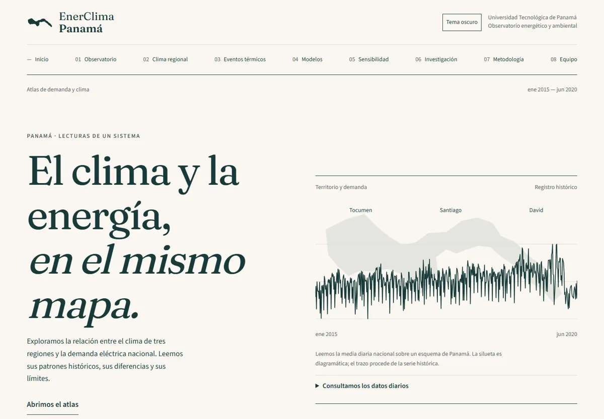
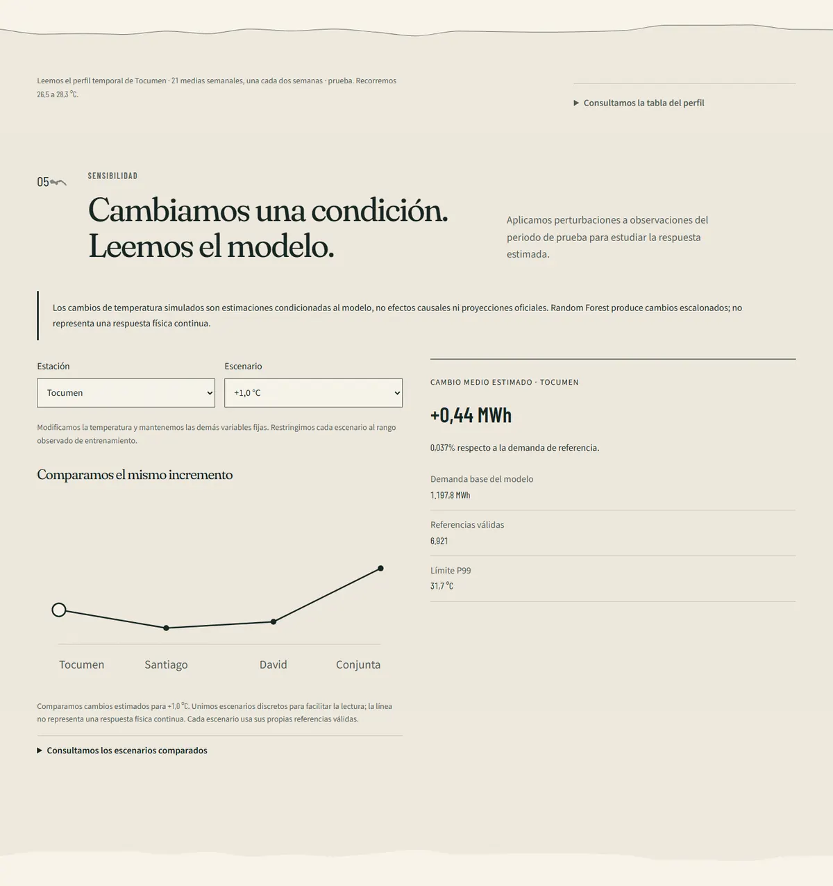

# EnerClima Panamá

[](https://charrixxz23.github.io/enerclima-panama/)

**[Abrir la aplicación EnerClima Panamá](https://charrixxz23.github.io/enerclima-panama/)**

<p align="center"></p>

> **El clima y la energía, en el mismo mapa.** Exploramos asociaciones históricas entre clima regional y demanda nacional, con sus límites visibles.

<picture><source srcset="web/public/previews/portada.avif" type="image/avif"></picture>

## El problema que estudiamos

En este proyecto analizamos cómo se relacionan las temperaturas observadas en Tocumen, Santiago y David con la demanda eléctrica nacional de Panamá. El calor puede cambiar las necesidades de refrigeración y coincide con patrones horarios y estacionales de consumo. Una lectura cuidadosa de estas señales aporta contexto para la planificación energética y ambiental.

Trabajamos con una serie horaria entre enero de 2015 y junio de 2020. El conjunto reúne 48.048 registros y 17 variables. La demanda está expresada en MWh por intervalo horario, según los metadatos recibidos.

## Hallazgos principales

- Nuestro modelo Random Forest obtuvo un MAE de **19,6 MWh**, un RMSE de **27,7 MWh** y un MAPE de **1,66%** en la prueba temporal.
- En las horas sobre el percentil 95 de temperatura, en Tocumen observamos una diferencia media de **199,8 MWh** respecto a las demás horas. Esta diferencia es descriptiva y no atribuye causalidad.
- Evaluamos por separado la referencia semanal de predespacho en 14 ventanas oficiales: MAE **59,2 MWh** y RMSE **74,0 MWh**.
- El modelo de una hora usa clima observado en la misma hora objetivo; por ello sus resultados son retrospectivos y no representan un pronóstico operativo.

## Qué podemos explorar

- Consultamos métricas y series agregadas de demanda nacional.
- Comparamos condiciones climáticas de las tres estaciones de referencia y vemos su mapa.
- Revisamos eventos sobre los umbrales descriptivos de temperatura.
- Comparamos modelos temporales y la referencia semanal del predespacho.
- Ajustamos escenarios de temperatura en un simulador basado en el modelo.
- Leemos metodología, referencias y limitaciones junto a los resultados.

<picture><source srcset="web/public/previews/simulador.avif" type="image/avif"></picture>

## Tecnologías y arquitectura

- **Análisis:** Python, pandas, NumPy, scikit-learn y Jupyter.
- **Observatorio:** Next.js, React, TypeScript, Recharts y React Leaflet.
- **Publicación:** exportación estática de Next.js, GitHub Actions y GitHub Pages.
- **Datos del sitio:** JSON agregado precalculado en `web/public/data/dashboard.json`; el navegador no necesita Python ni un servidor de análisis.

```text
scripts/             auditoría, análisis y exportación de métricas
notebooks/           cuaderno reproducible con resultados ejecutados
data/metadata/       diccionario de variables
results/             métricas agregadas, tablas y figuras
web/                 aplicación estática y pruebas de navegador
docs/                fuentes, límites, auditoría y cumplimiento
entregables/         materiales académicos privados, excluidos de Git
```

## Ejecución local

### Análisis en Python

Conservamos los datos fuente fuera del repositorio, en `data/raw/`. Descargamos el conjunto desde su fuente oficial cuando tengamos los permisos correspondientes o usamos una copia de trabajo autorizada. Para reproducir el análisis, creamos un entorno virtual y ejecutamos:

```powershell
python -m venv "$env:LOCALAPPDATA\EnerClima-Panama-venv"
& "$env:LOCALAPPDATA\EnerClima-Panama-venv\Scripts\Activate.ps1"
python -m pip install -r requirements.txt
python scripts/run_analysis.py
python scripts/export_web_data.py
```

El código construye rutas relativas desde el proyecto y funciona con espacios y tildes en la ruta. En Linux y Google Colab usamos la misma estructura del proyecto y el entorno equivalente.

### Aplicación web

Requerimos Node.js 20.9 o posterior. Desde `web/` instalamos paquetes y ejecutamos las comprobaciones y el sitio:

```bash
npm ci
npm run lint
npm run typecheck
npm run test:e2e
npm run dev
```

Para probar la exportación de GitHub Pages en Windows PowerShell:

```powershell
$env:GITHUB_PAGES = "true"
$env:NEXT_PUBLIC_BASE_PATH = "/enerclima-panama"
npm run build
```

La compilación estática aparece en `web/out/`. GitHub Actions instala las dependencias, ejecuta lint, tipos y pruebas de navegador, compila y publica ese directorio cuando recibe cambios en `main`.

## Integrantes

Alejandro Muñoz, Angie Valdés, Richard Smith y Abisai Bellamy. Realizamos el proyecto para Ingeniería Ambiental en la Universidad Tecnológica de Panamá, bajo la orientación de la profesora Vivian Valenzuela.

## Fuentes

- Aguilar Madrid, J. A. y Antonio, N. (2021). “Short-Term Electricity Load Forecasting with Machine Learning”. *Information, 12*(2), 50. [https://doi.org/10.3390/info12020050](https://doi.org/10.3390/info12020050)
- Aguilar Madrid, J. A. (2021). *Short-term electricity load forecasting (Panama)*. Mendeley Data, v1. [https://doi.org/10.17632/byx7sztj59.1](https://doi.org/10.17632/byx7sztj59.1)
- NASA. Documentación de variables meteorológicas MERRA-2 y NASA POWER.
- IPCC. *Climate Change 2022: Impacts, Adaptation and Vulnerability*, capítulo 12.
- ETESA, Centro Nacional de Despacho. Estadísticas del mercado eléctrico de Panamá.

La bibliografía completa y las definiciones de variables están en [referencias verificadas](docs/references/referencias_verificadas.md). Documentamos las limitaciones en [docs/LIMITACIONES.md](docs/LIMITACIONES.md).

## Privacidad y límites

No publicamos cédulas, informes identificados, datos fuente ni archivos cuya redistribución no esté confirmada. El repositorio contiene código, figuras y métricas agregadas. Conservamos seis observaciones bajas de demanda para revisión y no las corregimos ni eliminamos. Las asociaciones son observacionales; los escenarios de temperatura describen la respuesta del modelo y no son efectos causales ni proyecciones climáticas oficiales.


## Diseño del atlas

Organizamos la lectura en nueve anclajes estables. Desde la fase 1 del Bloque B construimos la portada con una superficie de demanda nacional y perfiles temporales de temperatura de Tocumen; agregamos ambas variables por bloques de cuatro días y hora. Añadimos un reloj horario, relieves mensuales, correlaciones frente a la demanda y un registro de calidad. Mostramos cifras abreviadas con una política común y conservamos los valores completos del JSON en los atributos de cada cifra. Ofrecemos alternativas textuales y tabulares para cada figura.

Alojamos Fraunces para titulares, Source Sans 3 para párrafos y Barlow Condensed para cifras y etiquetas, con sus licencias OFL. Cargamos mapas y Recharts al entrar en pantalla; el mapa usa nuestro SVG local. Desde el Bloque B mantenemos únicamente el tema claro y respetamos la preferencia de movimiento reducido. Declaramos sharp como única dependencia de desarrollo directa nueva para rasterizar el campo durante el build.

Documentamos los tokens, el uso de color, las pruebas y las mediciones en [docs/DISENO.md](docs/DISENO.md). Conservamos las evidencias completas en la carpeta local ignorada `evidencias/rediseno/`.

Antes del Bloque A verificamos nueve pruebas contra el sitio publicado y la exportación con su subruta. En las tres mediciones públicas actuales obtuvimos una mediana móvil de 86 en rendimiento y 100 en accesibilidad, buenas prácticas y SEO. Mantenemos pendiente la meta de rendimiento ≥95; documentamos las corridas y sus condiciones en el sistema de diseño.

## Presentación numérica

Centralizamos el formato en `web/lib/format.ts`: usamos coma decimal, punto de miles y precisión según la magnitud. Conservamos el JSON y los cálculos originales. Documentamos los casos y las excepciones en [FORMATO_CIFRAS.md](docs/FORMATO_CIFRAS.md). Ejecutamos las pruebas unitarias con `cd web` y `npm run test:unit`.

Para el Bloque A aprobamos lint, tipos, build, exportación, 13 pruebas unitarias y 10 pruebas de navegador. Conservamos los nueve anclajes y los valores originales del JSON.

## Campo conjunto de demanda y temperatura · fase 1

Exigimos tres observaciones por variable y celda; marcamos 23 celdas vacías. Anclamos la rampa térmica a p1 y p99 horarios, con inflexión en p95. Rasterizamos durante el build y limitamos a 120.000 bytes la suma de los cuatro AVIF y WebP de escritorio y móvil. Documentamos el hash SHA-256 de la entrada, los cuantiles, los colores y el comando exacto de regeneración en [DISENO.md](docs/DISENO.md). Conservamos el CSV privado y dashboard.json sin cambios.

Regeneramos los agregados desde la raíz con:

```sh
python scripts/build_thermal_field.py --input "data/raw/continuous dataset.csv" --output "web/public/data/thermal-field.json"
```
